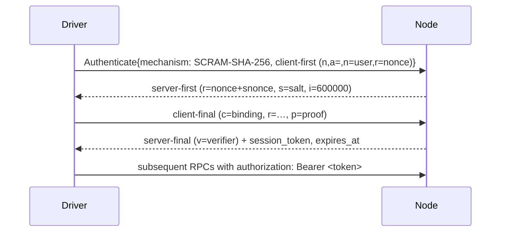

# API and Communication Protocol

> Status: **Definitive** (ADR-014). Contracts: `proto/rustegon/v1/*.proto` (gRPC, normative), `api/openapi/rustegon-v1.yaml` (REST, generated from the same service layer via `utoipa` and checked in CI).

## 1. Channels
| From → To | Protocol | Port | Auth | Encoding |
|---|---|---|---|---|
| .NET / Java drivers, CLI → node | gRPC over HTTP/2 + TLS (single node: opt-in, plain text by default, ADR-034) | 7700 | SCRAM / X.509 / API key → session token | protobuf envelopes; documents as RDoc `bytes` |
| GUI, tooling, curl → node | HTTP(S) REST (JSON) + WebSocket (`/api/v1/ws`); HTTPS when TLS is on (ADR-034) | 7780 | session cookie + CSRF, or `Authorization: Bearer`/API key | JSON (extended JSON for special types) |
| Prometheus → node | HTTPS `GET /metrics` (root path, outside `/api/v1`) | 7780 | `monitor` role or scrape API key (`cluster_view`, PD-059) | OpenMetrics text |
| Node ↔ node | gRPC over HTTP/2 + mTLS | 7710 | node certificate | protobuf (Raft messages batched, SST chunks streamed) |
| Cluster ↔ cluster (XDC) | gRPC + mTLS (cross-cluster trust bundle) | 7710 | cluster certificate | protobuf |

Engine and API live in the same process (`rustegond`); there is no separate backend service. The REST layer and gRPC layer call the same internal service traits (`rustegon-server::services`), so behaviour is identical.

## 2. gRPC services (package `rustegon.v1`)
| Service | Key RPCs |
|---|---|
| `AuthService` | `Authenticate` (bidi SASL SCRAM steps), `Logout`, `WhoAmI` |
| `SessionService` | `Ping`, `GetServerInfo` (versions, features, cluster topology hint) |
| `QueryService` | `Execute` (RGQL or AST; server-streaming batches), `GetMore`, `KillCursor`, `Explain` |
| `DocumentService` | `Get`, `GetMany`, `Insert`, `Replace`, `Update`, `Upsert`, `Delete`, `BulkWrite`, `Counters` |
| `TableService` | `Select`, `Write`, `Delete` (wide-column fast path with consistency aliases) |
| `TransactionService` | `Begin`, `Commit`, `Rollback`, `Status`, `Heartbeat` |
| `ChangeStreamService` | `Watch` (server streaming), `Subscription.{Create, Delete, List, Consume (bidi with acks)}` |
| `SchemaService` | databases, collections, tables, timeseries, indexes, validators CRUD; `IndexBuildProgress` |
| `ImportService` | `Import` (client streaming), `Export` (server streaming) |
| `AdminService` | users, roles, API keys, settings, zone configs, nodes (drain/decommission), ranges, jobs, transactions, queries, audit query, diagnostics |
| `BackupService` | M13a single node (PD-062, PD-077): `CreateBackup`, `ListBackups`, `GetBackup`, `VerifyBackup`, `CreateSnapshot`, `ListSnapshots`, `DeleteSnapshot`, `Dump` (server streaming), `LogicalRestore` (client streaming), `RestoreBackup`, `GetRestoreStatus` (online whole-node restore, ADR-037); M13b adds cluster `StartBackup`/`StartRestore` jobs, schedules, retention |
| `XdcService` | streams CRUD, status, failover |
| `Internal*` (peer port only) | `Raft.Batch`, `Raft.Snapshot`, `Kv.Batch`, `Exec.Fragment`, `RangeFeed`, `Gossip`, `Liveness` |

**v1 surface delivered in M4 (PD-045).** `proto/rustegon/v1` defines `AuthService`, `SessionService`, `QueryService`, `DocumentService` (without `Counters`: the engine has no document-counter API yet), `TransactionService`, `SchemaService` (databases, collections, indexes, `IndexBuildProgress`, validators) and `AdminService` (users, roles, API keys, settings). `TableService`, `ChangeStreamService`, `ImportService`, `XdcService`, the other `AdminService` areas (zone configs, nodes, ranges, jobs, transactions, queries, audit query, diagnostics) and the `Internal*` peer services are added **additively** by the milestones that implement them (§9); `Counters` is added with the counter API. TC-API-001 (`tc_api_001_descriptors_expose_exactly_the_m4_rpc_surface`) pins the exact RPC set, so a service cannot appear or vanish unnoticed.

Common request header (gRPC metadata): `authorization`, `rgn-request-id` (UUIDv7, client-generated for idempotency), `rgn-causality-token`, `rgn-txn-id`, `traceparent`, `grpc-timeout`. Response trailers: `rgn-causality-token`, `rgn-node-id`, `rgn-server-time`.

**Metadata rules (PD-050, normative; shared by gRPC and REST through `rustegon-server::services::RequestContext`):**
- Each header may appear at most once; a repeated or non-ASCII value fails with RGN-1001 `InvalidArgument` (`ErrorDetail.details.header` = header name; the value is never echoed).
- `rgn-request-id`: canonical hyphenated UUID (either case) of version 7 with the RFC 9562 variant, else RGN-1001. When absent the server generates a UUIDv7; only client-supplied ids create idempotency records (§5.1).
- `traceparent`: W3C Trace Context; an invalid value is **ignored** (as W3C requires) and a new trace id is generated. `ErrorDetail.trace_id` is always set (caller's or generated).
- `grpc-timeout`: 1–8 digits + `H|M|S|m|u|n`, else RGN-1001; it becomes the request deadline (§5.2).
- `rgn-txn-id` (≤ 256 bytes), `rgn-causality-token` (≤ 4 KiB), `authorization` (≤ 8 KiB): non-empty visible ASCII without spaces (`authorization` may contain spaces), else RGN-1001; their inner format is checked by the owning layer (transactions, consistency, authentication).
- Trailers: `rgn-node-id` (decimal node id) and `rgn-server-time` (server wall clock, Unix ms) on every response, including errors and unknown methods (in the header block of trailers-only error responses); `rgn-causality-token` when the operation returns one (session calls echo the client's token).

## 3. Core messages (abridged)
```protobuf
syntax = "proto3";
package rustegon.v1;

message Document { bytes rdoc = 1; }                 // RDoc v1 bytes
message Value    { bytes rdoc_value = 1; }           // single value encoding

message ExecuteRequest {
  string database = 1;
  oneof query { string rgql = 2; QueryAst ast = 3; }
  map<string, Value> params = 4;
  ExecOptions options = 5;                           // batch_size, max_time_ms, consistency, allow_disk_use, explain
  optional string txn_id = 6;
}
message ResultBatch {
  repeated Document docs = 1;
  map<string, Document> includes = 2;
  optional string cursor_id = 3;                     // present if more data
  optional bytes continuation_token = 4;             // keyset pagination
  QueryStats stats = 5;                              // on last batch
  repeated Warning warnings = 6;
  optional IndexStaleness staleness = 7;
}
message ErrorDetail {                                 // carried in google.rpc.Status.details
  uint32 code = 1; string name = 2; bool retryable = 3; optional bool committed = 4;
  map<string, string> details = 5; string trace_id = 6; optional uint32 retry_after_ms = 7;
}
```

**Message conventions of `rustegon.v1` (PD-045, normative):**
- Every RPC has its own `<Rpc>Request`/`<Rpc>Response` messages (`buf lint` STANDARD), so fields can be added to one RPC without affecting another. Streamed and paged results therefore wrap `ResultBatch`: `Execute` streams `ExecuteResponse{batch}`, `GetMore` returns `GetMoreResponse{batch}`.
- `ExecOptions` = `batch_size`, `max_time_ms`, `consistency`, `allow_disk_use`, `max_batches`, `continuation_token`, `write_concern`. `max_batches` bounds the `Execute` stream: after that many batches the stream ends and the last batch carries `cursor_id`; the client continues with `GetMore` (one batch per call) and releases it with `KillCursor` or by reading to the end. Without `max_batches` the stream runs to exhaustion under HTTP/2 flow control. Cancelling the `Execute` stream kills its cursor. EXPLAIN is the separate `Explain` RPC rather than an option flag.
- Timestamps are `int64` Unix milliseconds named `*_unix_ms`, not `google.protobuf.Timestamp`, so drivers need no well-known-type support.
- Every enum's zero value is `<ENUM>_UNSPECIFIED` and means "server default for this operation" (for example linearizable reads, majority write concern); servers treat unknown enum values as invalid arguments (RGN-1001).
- `DocumentService.Get` of a missing id returns an empty response (`document` absent), not an error; `GetMany` omits missing ids and keeps request order for the rest.
- `if_rev` on writes is the optimistic-concurrency precondition (REST `If-Match`): a mismatch fails with RGN-2009 `PreconditionFailed`.
- Settings travel as TOML text per key (`GetSettings` returns current and default values with secrets redacted; `UpdateSettings` applies a map of key → TOML value atomically), so the API does not have to mirror the settings registry's type system. *Provisional (PD-230):* `UpdateSettings` also accepts static settings when the node has a configuration file it may write: they are written into `rustegon.toml` (comments kept, the whole file validated first) and take effect at the next restart; a static setting set by an environment variable or a `--set` flag, a secret, a table, `node.data_dir` and the store encryption settings are refused with RGN-1001 (`details.reason` = `environment`, `secret`, `table`, `manual`, `no_config_file`).
- `ErrorDetail` (`rustegon/v1/error.proto`) travels packed as a `google.protobuf.Any` (`type.googleapis.com/rustegon.v1.ErrorDetail`) inside a standard `google.rpc.Status` in the `grpc-status-details-bin` trailer, so the usual rich-error support of gRPC client libraries can read it (`rustegon_proto::status::to_status` / `error_detail_of`).
- **Interactive transactions** (*Provisional (PD-049)*): `txn_id` is the canonical lowercase hyphenated UUID text of the 16-byte transaction id. Operations carrying a `txn_id` follow transactions.md §3 (statement errors keep the transaction, transaction errors abort it and are never retried by the server). `BeginResponse.heartbeat_interval_ms` = `txn.heartbeat_interval`; `HeartbeatResponse.expires_in_ms` = time until the transaction expires without another call (idle limit `txn.liveness_timeout` for read-write transactions, and `min(timeout, txn.max_duration)`). `StatusResponse.abort_reason` carries the `RGN-2002` reason string. An `Execute` with `txn_id` may leave a cursor (`max_batches`); its `GetMore` calls read through the transaction and fail once it committed (`RGN-1001`) or aborted (`RGN-2002`). Cancelling the `Execute` stream of a statement in a transaction cancels that statement only; killing a transaction (remote cancel) rolls it back with reason `killed`.
- **Data plane on one node** (*Provisional (PD-053)*): a transaction and a cursor belong to the principal that created them (any other caller gets RGN-1030); `BeginRequest.idle_timeout_ms` can only shorten `txn.liveness_timeout` and is enforced by the server for read-write and read-only transactions (idle → rolled back, RGN-2002 `timeout_pushed`); `StatusResponse` reports an outcome-unknown commit (RGN-2006) as `COMMITTING`; finished transactions stay queryable 10 min. **After a restart** (*Provisional (PD-121 option (a'), PD-123)*) an id the node's registry does not hold is looked up in the store (a scan of the transaction-record keyspace): a `PENDING` record younger than `txn.liveness_timeout` → `COMMITTING`; older → aborted durably, `ABORTED` `coordinator_lost` (and `Commit` → RGN-2002 `coordinator_lost`, retryable; `Rollback` → `{}`); `ABORTED` record → the same; no record → RGN-1030 as before (it may have committed: never `ABORTED`). The owner is not persisted, so any authenticated principal may ask about such an id (REST `GET /transactions/{id}` and `POST …/commit|rollback` behave identically). `Value.rdoc_value` is the RDoc encoding of a field value (type tag + payload, no document header). `ResultBatch.docs` carries non-document rows as `{"value": row}`. `GetMore.batch_size` applies to that and later batches. `ExecOptions.max_time_ms` covers all batches of a cursor; `allow_disk_use` is accepted without effect in M4. `if_rev` on a missing document is RGN-2009. `BulkWrite` runs in one transaction: outside an interactive transaction failed operations are reported in `errors` and rolled back alone while the others commit together (`ordered` stops at the first failure); inside one, any failure fails the call and undoes the whole bulk, leaving the transaction active. Read consistencies are all served by the single replica at its latest state (`BOUNDED_STALENESS` needs `max_staleness_ms`); write concerns `MAJORITY`/`ALL` hold on one node, the cross-datacenter concerns are RGN-1001 until XDC collections exist.

## 4. REST API (`/api/v1`)
Resource-oriented, JSON, OpenAPI 3.1. Representative endpoints:

| Method & path | Purpose |
|---|---|
| `POST /auth/login` (SCRAM over 2 calls: `/auth/scram/start`, `/auth/scram/finish`; plain password login over TLS allowed for GUI with server-side SCRAM verification) · `POST /auth/logout` · `GET /auth/me` · `POST /auth/password` (own password, PD-055) | session |
| `GET/POST /databases` · `GET/PATCH/DELETE /databases/{db}` (`PATCH`: no alterable database option yet) | databases |
| `GET/POST /databases/{db}/collections` · `GET/PATCH/DELETE …/collections/{c}` · `GET/PUT/DELETE …/collections/{c}/validator` (PD-055) | collections |
| `GET/POST …/collections/{c}/documents` (list with filter/sort/limit, insert) · `GET/PUT/PATCH/DELETE …/documents/{id}` · `POST …/collections/{c}/get-many` · `POST …/collections/{c}/bulk` (PD-055) | documents (`If-Match: <_rev>` supported) |
| `POST /databases/{db}/query` (RGQL + params → first batch; `cursorId`) · `POST /cursors/{id}/next` · `DELETE /cursors/{id}` | queries |
| `POST /databases/{db}/explain` | plans |
| `GET/POST/DELETE …/collections/{c}/indexes[/{name}]` · `GET …/indexes/{name}/progress` · `GET /advisor/recommendations` | indexes |
| `POST /transactions` · `POST /transactions/{id}/commit|rollback|heartbeat` · `GET /transactions/{id}` (status, PD-055) · `GET /transactions` · `DELETE /transactions/{id}` (kill) | txns |
| `GET/POST/PATCH/DELETE /users`, `/roles`, `/api-keys` (`GET/POST /x`, `GET/PATCH/DELETE /x/{name}`; API keys: `DELETE /api-keys/{key_id}`, no `PATCH`) | security |
| `GET /cluster`, `/cluster/nodes`, `/cluster/nodes/{id}`, `POST …/drain|decommission`, `GET /cluster/ranges?collection=`, `/cluster/hot-ranges`, `/cluster/zone-configs` | cluster |
| `GET/POST /backups`, `GET /backups/{id}`, `POST /backups/{id}/verify`, `POST /backups/{id}/restore`, `GET /restore-status` (ADR-037), `GET/POST /snapshots`, `DELETE /snapshots/{name}` (M13a, PD-077), `GET/POST /dumps`, `POST /dumps/{id}/restore` (PD-226), `POST /dumps/restore-file` (PD-229) · `POST /restores`, `GET/POST /backup-schedules` (M13b) | backup |
| `GET /settings` · `PATCH /settings` · `POST /node/restart` (PD-230) | config |
| `GET /diagnostics/{queries|query-stats|slow-queries|lock-waits|jobs|ranges-problems}`, `GET /logs?channel=&level=&since=` (streams via WS) | diagnostics |
| `GET /metrics/summary?window=` (pre-aggregated time series for GUI charts, from in-process TSDB ring, 24 h at 10 s resolution) | monitoring |
| `GET /health/live`, `GET /health/ready` (no auth) | health |
| `GET /ping` · `GET /server-info` | session (`SessionService.Ping` / `GetServerInfo`, PD-052) |

**REST conventions (PD-052, normative; served by `rustegon-server::rest`):**
- Listener: its own port 7780 (not content-type routing on 7700), HTTP/1.1 and HTTP/2 (TLS ALPN `h2`, `http/1.1`; plain text under the same single-node `security.tls = false` policy as gRPC (ADR-034), then HTTP/1.1 or h2c prior knowledge). Same TLS configuration, handshake bound (10 s) and graceful drain as the gRPC listener; HTTP/1.1 request heads must arrive within 10 s.
- Request headers: the gRPC names and rules of §2 (`rgn-request-id`, `traceparent`, `rgn-txn-id`, `rgn-causality-token`, `authorization`; each at most once), with `X-RGN-Timeout-Ms` instead of `grpc-timeout`: 1–8 ASCII digits = milliseconds (`0` = already expired), else RGN-1001 (`details.header` = `x-rgn-timeout-ms`). `grpc-timeout` is not interpreted on REST. No default deadline at the transport level; the query endpoints apply the GUI default of §5.2 (60 s; PD-055).
- Response headers on every response (success, error, unknown route): `rgn-node-id`, `rgn-server-time` (the gRPC trailers; HTTP/1.1 trailers are unusable from browsers), plus `Cache-Control: no-store` and `X-Content-Type-Options: nosniff`; `rgn-causality-token` on successful operations that return one (session calls echo the client's token).
- Credentials: `Authorization: Bearer <session token>` or `Authorization: ApiKey rgn_…`; without `Authorization`, the GUI's `rgn_session` cookie (base64url token; repeated or malformed → RGN-1001 `details.header` = `cookie`) is presented to the authentication layer as `Bearer <token>`. State-changing methods (anything but `GET`/`HEAD`/`OPTIONS`) authenticated by the cookie must send `X-RGN-CSRF` = the session's CSRF token, lowercase hex of BLAKE3 `derive_key("rustegon 2026-11 csrf token v1", session token)` (signed double-submit; delivered to the GUI by the login endpoint in the readable `rgn_csrf` cookie); missing or wrong → RGN-4002 (`details.reason` = `csrf`). A request carrying `Authorization` ignores the cookie and needs no CSRF token. Principal resolution is pluggable (`services::PrincipalResolver`).
- Bodies: JSON with camelCase field names; documents as extended JSON (`rustegon-doc`). Request bodies are limited to 64 MiB (RGN-1002, 413; *Provisional (PD-106)*: the server stops reading at the limit, answers 413 and closes the connection, so over HTTP/2 the client receives the 413, while an HTTP/1.1 client still sending the body usually sees the connection reset before it can read the answer: clients check the size before sending); a missing `Content-Type: application/json`, invalid JSON or a body of the wrong shape is RGN-1001 (`details.body` = `content-type` / `syntax` / `data`); messages never quote the body.
- Errors: §7 body and status; unknown path → 404 RGN-1030; known path with another method → **405** with RGN-1001 (the only status not taken from the catalog). Successful session responses: `GET /ping` → `{}`, `GET /server-info` → `{serverVersion, protocolVersion, features, nodeAddresses}`, `GET /health/live` → `{"status": "live"}` (reads no header, never authenticates). `GET /health/ready` (*Provisional (PD-059)*) reads no header either: 200 `{"status": "ready"}` while the node serves and its store accepts writes, otherwise 503 `{"status": "starting" | "draining" | "unhealthy"}` (before both listeners are up; from the start of a graceful shutdown, for `listen.drain_delay_secs` before the listeners close; after a failed apply poisoned the store). `GET /metrics` (root path) is served by the same listener through the same gate with the HTTP-only rule `GET /metrics` = `cluster_view` on `cluster` (`security::HTTP_ACCESS`, listed in `REST_ENDPOINTS`); response `application/openmetrics-text; version=1.0.0; charset=utf-8`, families in system-overview.md §7.
- OpenAPI: generated from the handlers (`utoipa`), checked in as `api/openapi/rustegon-v1.yaml` and compared in a test (`tc_api_002_checked_in_openapi_matches_the_code`; regenerate with `RGN_OPENAPI_BLESS=1`). Every operation references the shared header parameters, response headers and the `Error` response; security schemes `bearer`, `apiKey`, `sessionCookie`. `oasdiff breaking` (TC-API-002) runs against the last released document once a release exists.

**REST endpoints of M4 (PD-055, normative; `rustegon-server::rest::REST_ENDPOINTS` is the source of truth and is pinned to the OpenAPI document by `tc_api_002_every_documented_route_is_in_the_endpoint_table`).** Every endpoint maps to one RPC of §2; the REST gate (`rest::gate`, a route layer that runs after routing and before any path/query/body parsing) applies that RPC's access rule exactly like the gRPC gate (PD-051): no rule → RGN-5001; data-plane endpoints on a node without an engine → 404 RGN-1030; anonymous rules rate limited per address; otherwise headers + credentials (cookie + CSRF) → principal → RGN-4001 without one → rate limit → must-change-password and cluster privileges (RGN-4002, audited); database/collection privileges are checked by the services. All successes are `200` with a JSON body (`{}` when there is nothing to return).

| Method & path (`/api/v1` prefix omitted) | RPC | Notes |
|---|---|---|
| `POST /auth/scram/start` `{clientFirst, delivery?, clientInfo?}` → `{handshakeId, serverFirst}` · `POST /auth/scram/finish` `{handshakeId, clientFinal}` → login | `AuthService.Authenticate` | handshake kept ≤ 30 s, once, bound to the source address, ≤ 10 000 per node (RGN-5004); unknown/expired/foreign/reused id → RGN-4001; `p=tls-exporter` needs both calls on the same TLS 1.3 connection |
| `POST /auth/login` `{user, password, delivery?, clientInfo?}` → login | `AuthService.Authenticate` | server runs the SCRAM client side against itself (same lockout, rate limits, fake salt, audit) |
| `POST /auth/logout` · `GET /auth/me` | `Logout` · `WhoAmI` | logout clears both cookies, also when refused for a dead session (not on a CSRF failure) |
| `POST /auth/password` `{currentPassword, newPassword}` | `AdminService.ChangePassword` | allowed while a password change is required |
| `GET/POST /users` · `GET/PATCH/DELETE /users/{name}` · same for `/roles`, `/roles/{name}` · `GET/POST /api-keys` (`?user=`) · `DELETE /api-keys/{key_id}` · `GET /settings` (`?names=a,b`) → `{settings: [{name, value, defaultValue, runtimeMutable, description, kind, min?, max?, choices?, locked?, pendingValue?}], lastRestartError?}` · `PATCH /settings` `{values: {name: toml}}` · `POST /node/restart` → `{restarting: true}` (REST only, rule of `UpdateSettings`; PD-230: the node stops serving after the answer and serves again in the same process with its configuration file read again; a configuration it cannot start with falls back to the previous one, reported as `lastRestartError`) | `AdminService.*` | role grants as `{role, resource}` (§8 mapping); the API key secret only in the `POST` response |
| `POST /transactions` · `GET /transactions/{txn_id}` · `POST /transactions/{txn_id}/commit|rollback|heartbeat` | `TransactionService.*` | statements carry `rgn-txn-id` (or `txnId` in a query body) |
| `POST /databases/{db}/query` `{rgql | ast, params?, options?, txnId?}` → `{rows, cursorId?, continuationToken?, stats?, warnings}` · `POST /databases/{db}/explain` (`analyze`) → `{plan}` · `POST /cursors/{cursor_id}/next` (`?batchSize=`) · `DELETE /cursors/{cursor_id}` → `{killed}` | `Execute` (`max_batches` = 1) · `Explain` · `GetMore` · `KillCursor` | without `X-RGN-Timeout-Ms` the query, explain, next and list endpoints get the 60 s GUI deadline (§5.2); rows are returned as values (no `{"value": row}` wrapping); `ast` is the JSON form of query-language.md §13; tokens base64url |
| `GET/POST /databases` · `GET/DELETE /databases/{db}` · `GET/POST /databases/{db}/collections` · `GET/PATCH/DELETE …/collections/{coll}` · `GET/POST …/{coll}/indexes` · `GET/DELETE …/indexes/{name}` · `GET …/indexes/{name}/progress` · `GET/PUT/DELETE …/{coll}/validator` | `SchemaService.*` | single database/index answered from the listing (RGN-1030/RGN-1021 when absent); index `definition` = `CREATE INDEX` in the AST JSON form, must name the path's collection; `?ifExists=true` on drops |
| `GET …/{coll}/documents` (`?filter=&sort=&limit=&continuationToken=&consistency=&maxStalenessMs=`) → `{documents, continuationToken?}` | `QueryService.Execute` | ``FROM `coll` [WHERE (filter)] ORDER BY …`` (filter = one RGQL expression, re-printed canonically; sort = field paths, `-` descending, default `_id`; limit 1–10 000, default 100); stateless (the cursor is closed) |
| `POST …/{coll}/documents` `{documents, options?}` · `GET/PUT/PATCH/DELETE …/documents/{id}` · `POST …/{coll}/get-many` `{ids}` · `POST …/{coll}/bulk` `{operations: [{op, document?, id?, operations?, ifRev?}], ordered?, params?}` | `Insert` · `Get`/`Replace` (`?upsert=true`: `Upsert`)/`Update`/`Delete` · `GetMany` · `BulkWrite` | `{id}` = an extended-JSON value (`42`, `"42"`, `{"$oid":…}`), otherwise the segment as a string; `If-Match: "<_rev>"` (one strong tag; `*`, weak and lists → RGN-1001) = `if_rev`, `ETag` = `_rev`; `GET` of a missing document → 404 RGN-1030; `PUT` body `_id` must equal `{id}` (added when absent); `PATCH` `{operations (AST JSON update ops), params?}`; `?writeConcern=`, `?returnDocument=none|before|after` (`DELETE`: `true`) |

**Backup endpoints of M13a (*Provisional (PD-077)*; `BackupService`, every rule `backup` on `cluster`, PD-062).** `GET /backups?destination=` → `{backups: [backup], unreadable: [{backupId, error}]}` (`ListBackups`) · `POST /backups` `{destination}` → `{backup, warnings}` (`CreateBackup`) · `GET /backups/{backup_id}?destination=` → `{backup, files: [{path, size, blake3}]}` (`GetBackup`) · `POST /backups/{backup_id}/verify` `{destination, deep?}` → `{backup, filesChecked, bytesHashed}` (`VerifyBackup`; a failed verification is RGN-5002) · `GET /snapshots` → `{snapshots}` · `POST /snapshots` `{name}` → `{snapshot}` · `DELETE /snapshots/{name}` → `{deleted}`. `backup` = `{backupId, formatVersion, createdAtUnixMs, consistency: {timestamp: {wallNs (decimal string), logical}, appliedIndex, appliedTerm, storageSeqno}, sourceClusterId, sourceNodeId, sourceServerVersion, encryption: plaintext|kek, kekId?, fileCount, totalBytes}`. A destination is an absolute path on the server or a `file://` / `s3://` URL without credentials (relative path → RGN-1001; a missing local directory is RGN-1030 for reads and is never created by them). `Dump` (server stream: `started{T}`, then `DumpChunk{path, data, endOfFile}` with files contiguous and `dump.json` last) and `LogicalRestore` (client stream: `options{dropExisting, databases, collections}` first, then the chunks; `restore` privilege) are gRPC only. A destination outside the server's allowlist (`<data_dir>/backups` plus `backup.allowed_destinations`, PD-082) is RGN-4002 with `details.reason = destination_not_allowed`. A server built without a backend answers `CreateBackup`, the snapshot RPCs, `Dump` and `LogicalRestore` with RGN-5007 and `details.reason = not_implemented` (`details.operation` = the RPC); `rustegond` installs the engine backend (M13a lanes BE, BG). `POST /backups/{backup_id}/restore` `{destination}` → `{backup}` (`RestoreBackup`, privilege `restore`; ADR-037): the backup (`<id>.bak` or a backup directory) is deep-verified, then the node stops serving, replaces its store with the backup and serves again in the same process; the response comes before the stop. `GET /restore-status` → `{state: none|completed|failed, backupId?, finishedAt?, error?, previousStore?}` (`GetRestoreStatus`, privilege `backup`). Snapshot, point-in-time and new-data-directory restores are offline CLI operations without RPC. **Dumps at a destination** (*Provisional (PD-226)*; REST only, the GUI's backup of one database): `GET /dumps?destination=` → `{dumps: [dump], unreadable: [{dumpId, error}]}` (rule of `ListBackups`) · `POST /dumps` `{destination, databases?, collections?}` → `{dump}` (rule of `Dump`, privilege `backup`; the server writes one compressed file `<id>.dbck` at the destination, PD-227) · `POST /dumps/{dump_id}/restore` `{destination, databases?, collections?, dropExisting?}` → `{sourceTimestamp, collections: [{database, collection, documents, indexes}]}` (rule of `LogicalRestore`, privilege `restore`; RGN-1030 for a missing `.dbck`, RGN-1031 for an existing target without `dropExisting`) · `POST /dumps/restore-file?dropExisting=` with the `.dbck` file as an `application/octet-stream` body → the same response (rule of `LogicalRestore`, privilege `restore`; PD-229): the whole file is restored; the body is streamed to the node's spool and is not bound by the JSON body limit, at most 64 GiB (RGN-1001 above, or for another content type or a `.nbck`), RGN-5002 for a file that is not a well-formed `.dbck`. `dump` = `{dumpId, timestamp, createdAtUnixMs, databases: [{name, collections: [{name, documents}]}]}`.

Documents and values are extended JSON in requests (parsed from the raw request text, so field order and duplicate-name rejection are preserved) and canonical extended JSON in responses. Enumerations are lowercase snake case (`linearizable`, `bounded_staleness`, `majority`, `read_committed`, `before`, …); unknown values fail the body with RGN-1001.

**GUI assets (*Provisional (PD-130, PD-131)*; ADR-027).** The REST listener also serves the built GUI (`gui/dist/`, base href `/ui/`, embedded into `rustegond`) unless `gui.enabled = false`; these routes are not API operations (not in `REST_ENDPOINTS` or the OpenAPI document, not behind the gate, without the `rgn-*` headers). `GET`/`HEAD /` and `/ui` → 303 `Location: /ui/`; `/ui/<file>` → the file with its content type and a strong `ETag` (`If-None-Match` → 304), `Cache-Control: public, max-age=31536000, immutable` for content-hashed names (`main-ABCD1234.js`) and `no-cache` for `index.html` and other files; any other `/ui/...` path → `index.html` (SPA deep links); paths with `.`/`..` segments, backslashes or control characters (also percent-encoded) → 404; a build without the GUI → 503 `text/plain`. Every GUI response carries `Content-Security-Policy: default-src 'none'; script-src 'self'; style-src 'self' 'unsafe-inline'; img-src 'self' data:; font-src 'self' data:; connect-src 'self'; worker-src 'self' blob:; manifest-src 'self'; base-uri 'self'; form-action 'self'; frame-ancestors 'none'; object-src 'none'`, `X-Frame-Options: DENY`, `Referrer-Policy: no-referrer`, `X-Content-Type-Options: nosniff`. With the GUI disabled, `/` and `/ui...` are unknown paths (404 RGN-1030); other paths answer as above in every case.

### 4.1 WebSocket `/api/v1/ws`
Multiplexed JSON frames `{id, type: "subscribe|unsubscribe|event|error", topic, payload}`; topics: `changes:{db}.{coll}` (change stream with filter), `logs`, `metrics`, `jobs`, `cluster-events`. Authenticated by session cookie at upgrade + CSRF token in first frame.
*Not served yet (PD-052):* none of the topics has a producer in M4 (change streams, log/metric/job feeds and cluster events arrive with their milestones), so the endpoint is added together with the first topic; the upgrade will go through the REST listener (HTTP/1.1 upgrade; the auto connection is then switched to `serve_connection_with_upgrades`).

## 5. Operations semantics
### 5.1 Idempotency
Mutating RPCs accept `rgn-request-id`; the server keeps a dedup record (per session, 10 min) so retries after network errors are safe for non-transactional ops. Transactional ops are idempotent by `(txn_id, seq)`.
*Provisional (PD-053), M4 single node*: records are keyed by (principal, request id) and hold the **successful** outcome of the first attempt for 10 min (a failed attempt wrote nothing, so its retry runs again); a retry arriving while the first attempt runs waits for it; the same id used for another operation is RGN-1001. The store is per node, in memory and bounded (100 000 records; RGN-5004 when full of in-flight writes): a server restart or a retry sent to another node executes the write again. Inside an interactive transaction there is no per-statement dedup yet (`seq` is not on the wire); `Commit` is idempotent by `txn_id`.
### 5.2 Timeouts
gRPC deadlines (`grpc-timeout`) map to server `max_time_ms`; REST `X-RGN-Timeout-Ms` header (1–8 decimal digits of milliseconds, §4 conventions; default 60 s for GUI queries). Server propagates remaining deadline to fragments.
An expired deadline fails with RGN-5006 `DeadlineExceeded` (with `ErrorDetail`); a client that cancels the call cancels the server-side work cooperatively (RGN-5005 internally). Engine calls run on a bounded blocking pool: reads stop waiting at the deadline, writes always report their real outcome even after the deadline, so a mutation is never reported as failed while it committed (PD-050).
### 5.3 Connection management
HTTP/2 keepalive ping 30 s, timeout 10 s; max concurrent streams 256 per connection; drivers pool connections (§ driver specs) and spread across nodes; `GetServerInfo` returns node list for topology-aware routing (optional, drivers route to any node by default).
### 5.4 Bulk payloads
`BulkWrite` ≤ 100 000 ops and ≤ 48 MiB per request; larger → use `ImportService` streaming or multiple requests.
### 5.5 Pagination
Cursor-based (`cursor_id` + `GetMore`) for streaming, and keyset continuation tokens for stateless paging (GUI grids). `OFFSET` supported but discouraged beyond 10 000 (warning).

## 6. Streaming
- Query results: server streaming of `ResultBatch`; client flow control via HTTP/2 windows; `batch_size` hint. The server produces at most one batch ahead of the client; cancelling the stream stops the batch in progress and closes the cursor. A cursor left by `max_batches` is closed after 10 min without `GetMore` (FR-QL-006; in M4 its snapshot also ends at `txn.max_duration`, RGN-2003), a `GetMore` cancelled or past its deadline kills it, and open cursors are bounded per principal and per node (RGN-5004) (*Provisional (PD-053)*). Continuation tokens are sealed with AES-256-GCM and bound to the principal; any altered, foreign or (with the default per-process key) pre-restart token is RGN-1001.
- Change streams: server streaming `ChangeEvent` + periodic `Resolved`; resume with `resume_token`; heartbeat every 5 s when idle.
- Subscriptions: bidi; client sends `Ack{batch_id}`; server sends `Batch`.
- Import: client streaming of `ImportChunk` (NDJSON or RDoc frames), server returns summary.

## 7. Error model
gRPC status code + `ErrorDetail` (§3); REST: HTTP status + body `{"error": {code, name, message, retryable, committed?, details, traceId}}`.

| Code | Name | gRPC | HTTP | Retryable |
|---|---|---|---|---|
| 1001 | InvalidArgument | INVALID_ARGUMENT | 400 | no |
| 1002 | DocumentTooLarge | INVALID_ARGUMENT | 413 | no |
| 1003 | NestingTooDeep | INVALID_ARGUMENT | 400 | no |
| 1004 | InvalidFieldName | INVALID_ARGUMENT | 400 | no |
| 1005 | DuplicateKey | ALREADY_EXISTS | 409 | no |
| 1006 | SchemaValidationFailed | INVALID_ARGUMENT | 422 | no |
| 1007 | PartitionTooLarge | FAILED_PRECONDITION | 409 | no |
| 1008 | IndexKeyTooLarge | INVALID_ARGUMENT | 400 | no |
| 1009 | CounterOverflow | OUT_OF_RANGE | 422 | no |
| 1010 | QuerySyntaxError | INVALID_ARGUMENT | 400 | no |
| 1011 | QueryTypeError | INVALID_ARGUMENT | 400 | no |
| 1012 | UnknownFunction | INVALID_ARGUMENT | 400 | no |
| 1013 | QueryTooComplex / ScanNotAllowed | INVALID_ARGUMENT | 400 | no |
| 1020 | IndexAlreadyExists | ALREADY_EXISTS | 409 | no |
| 1021 | IndexNotFound | NOT_FOUND | 404 | no |
| 1022 | IndexBuildFailed | FAILED_PRECONDITION | 409 | no |
| 1023 | IndexLimitExceeded | RESOURCE_EXHAUSTED | 409 | no |
| 1024 | IndexStaleTimeout | DEADLINE_EXCEEDED | 504 | yes |
| 1025 | MultikeyCompoundArrays | INVALID_ARGUMENT | 400 | no |
| 1030 | NotFound | NOT_FOUND | 404 | no |
| 1031 | AlreadyExists | ALREADY_EXISTS | 409 | no |
| 1032 | ResumeTokenExpired | OUT_OF_RANGE | 410 | no |
| 1033 | SchemaChangeInProgress | ABORTED | 409 | yes |
| 1034 | DescriptorVersionMismatch (internal) | ABORTED | 409 | yes |
| 1040 | InvalidVector | INVALID_ARGUMENT | 400 | no |
| 1041 | InvalidGeometry | INVALID_ARGUMENT | 400 | no |
| 2001 | TransactionConflict | ABORTED | 409 | yes |
| 2002 | TransactionAborted | ABORTED | 409 | per reason |
| 2003 | TransactionTimeout | DEADLINE_EXCEEDED | 408 | no |
| 2004 | TransactionTooLarge | RESOURCE_EXHAUSTED | 413 | no |
| 2005 | DeadlockDetected | ABORTED | 409 | yes |
| 2006 | CommitOutcomeUnknown | UNKNOWN | 500 | special |
| 2007 | ReadTimestampTooOld | ABORTED | 409 | yes |
| 2008 | WriteTooOld | ABORTED | 409 | yes |
| 2009 | PreconditionFailed | FAILED_PRECONDITION | 412 | no |
| 3001 | NotLeaseholder (internal) | UNAVAILABLE | 503 | yes |
| 3002 | Unavailable | UNAVAILABLE | 503 | yes |
| 3003 | RangeKeyMismatch (internal) | UNAVAILABLE | 503 | yes |
| 3004 | NodeDraining | UNAVAILABLE | 503 | yes (other node) |
| 3005 | ClockOffsetExceeded | UNAVAILABLE | 503 | yes (other node) |
| 3006 | WriteConcernTimeout | DEADLINE_EXCEEDED | 504 | no (committed=true) |
| 3007 | StaleReadUnavailable | UNAVAILABLE | 503 | yes |
| 4001 | Unauthenticated | UNAUTHENTICATED | 401 | no |
| 4002 | PermissionDenied | PERMISSION_DENIED | 403 | no |
| 4003 | RateLimited | RESOURCE_EXHAUSTED | 429 | yes (after) |
| 4004 | TlsRequired | FAILED_PRECONDITION | 426 | no |
| 4005 | SessionExpired | UNAUTHENTICATED | 401 | yes (re-auth) |
| 4006 | KeyUnavailable | FAILED_PRECONDITION | 503 | no |
| 4007 | AccountLocked | PERMISSION_DENIED | 423 | no |
| 5001 | Internal | INTERNAL | 500 | no |
| 5002 | StorageCorruption | DATA_LOSS | 500 | no |
| 5003 | DiskFull | RESOURCE_EXHAUSTED | 507 | yes |
| 5004 | ResourceExhausted | RESOURCE_EXHAUSTED | 503 | yes |
| 5005 | Cancelled | CANCELLED | 499 | no |
| 5006 | DeadlineExceeded | DEADLINE_EXCEEDED | 504 | no |
| 5007 | VersionIncompatible | FAILED_PRECONDITION | 400 | no |

Codes are append-only; names and meanings never change (compatibility rule).

## 8. Authentication flow (gRPC)

On the wire (`proto/rustegon/v1/auth.proto`, PD-045) the whole exchange is one bidirectional `Authenticate` stream: the client's first `AuthenticateRequest` carries `mechanism`, the SASL `payload` (client-first) and `client_info`; the server answers with `AuthenticateResponse{challenge}` (server-first); the client sends the client-final `payload`; the server answers `AuthenticateResponse{success: AuthSuccess{server_final, session_token, expires_at_unix_ms, …}}` and ends the stream. The client must verify `server_final` before using the token. Any failure ends the stream with a gRPC error carrying `ErrorDetail` (RGN-4001 `Unauthenticated` — identical for unknown users and wrong passwords —, RGN-4007 `AccountLocked`, RGN-4003 `RateLimited` with `retry_after_ms`).

API keys: `authorization: ApiKey rgn_…` (no handshake). X.509: TLS client cert, then `Authenticate{mechanism: X509}` with an empty payload returns `success` directly (empty `server_final`).

**Details (*Provisional (PD-051)*).** `AUTH_MECHANISM_SCRAM_SHA_256` covers both SCRAM variants: a client-first message whose gs2 header is `p=tls-exporter` selects SCRAM-SHA-256-PLUS. The server binds to the RFC 9266 `tls-exporter` (label `EXPORTER-Channel-Binding`, no context, 32 bytes) of TLS 1.3 connections; on such a connection the `y` flag is a downgrade and fails. The server waits at most 30 s (or the request deadline) for the client-final message. Any other mechanism value is RGN-1001 (`details.field = mechanism`). For an `x509:` user `Authenticate{X509}` returns a session token; for a node certificate it returns `success` with an empty `session_token` and `expires_at_unix_ms = 0`. A request without `authorization` on a connection with a verified client certificate is authenticated by that certificate; `authorization`, when present, always wins. The authorization scheme names (`Bearer`, `ApiKey`) are case-insensitive; another scheme is RGN-4001; an expired or revoked session is RGN-4005. Lockout (RGN-4007) is checked before the credentials. `RoleGrant{role, resource}` maps to role references as `{r, "database:db"}` = `r@db`, `{r, "collection:db.c"}` = `r@db.c`, `{r, "" | "cluster" | "database:*"}` = `r` (responses use `cluster` for cluster roles, `database:*` for unscoped database roles, `""` for custom roles). `WhoAmI.mechanism` reports how the session was created (recorded in its `client_info`). `UpdateSettings` accepts runtime-mutable settings only (others RGN-1001, unknown names RGN-1030); the values persist cluster-wide and take precedence over the node's configuration file.

## 9. Versioning and compatibility
- Package `rustegon.v1` / `/api/v1` is stable: only **additive** changes (new fields with new numbers, new RPCs, new enum values with `UNKNOWN=0` handling, new error codes). Removal/renaming requires `v2` and a deprecation period of ≥ 2 minor releases with both served.
- `GetServerInfo` returns `server_version` (semver), `protocol_version` (`1.<minor>`), `features[]` (e.g. `vector`, `xdc`). Drivers negotiate: a driver works with any server sharing major protocol version; features gated by capability flags, not by version comparisons.
- Compatibility window: drivers N support servers N−2..N+1 (minor). Inter-node: nodes of adjacent minor versions interoperate during rolling upgrade (cluster version gating, database-engine §8).
- RDoc format versioned by header byte; servers accept all older versions.

## 10. Contract tests
- TC-API-001 `buf lint` + `buf breaking` against last released protos (CI gate). *Provisional (PD-060)*: `scripts/ci-local.sh` compares against the tag `api-v1-alpha` (taken at the M4 exit; skipped with a message before it exists or without buf/npx); the stable test `tc_api_001_wire_contract_matches_the_lock` checks every RPC, field (number, label, type, JSON name), enum value and reserved range of `rustegon.v1` against `proto/rustegon/v1.lock` (lines may be added, never changed or removed; bless additions with `RGN_PROTO_LOCK_BLESS=1`) and that every enum starts with `*_UNSPECIFIED = 0`.
- TC-API-002 OpenAPI diff (`oasdiff breaking`) against last release (CI gate). Same baseline as TC-API-001 (`oasdiff` or docker `tufin/oasdiff`); every `$ref` of the document must resolve (`tc_api_002_every_openapi_reference_resolves`).
- TC-API-003 golden request/response fixtures per RPC (`api/fixtures/*.json`) replayed against server. *Provisional (PD-060)*: one scenario per service and channel (`grpc-<service>.json`, `rest-<area>.json`) replayed step by step on a fresh in-process node by `crates/rustegon-server/tests/golden_api.rs`; gRPC messages in the protobuf JSON mapping (RDoc bytes shown as `{"$rdoc": …}` / `{"$rdocValue": …}` extended JSON), REST as status + headers + body; values captured from responses are reused as `${name}`, volatile values (tokens, ids, timestamps, revisions, trace ids, SCRAM messages, timings) become placeholders; every RPC and REST endpoint needs ≥ 1 successful step (*Provisional (PD-077)*: the `BackupService` operations waiting for the M13a wave-2 backend, listed in `PENDING_BACKEND`, are covered by a step recording their RGN-5007 `not_implemented` until a success replaces it; the variables `${backup_dest}` / `${backup_dest_q}` name a seeded local backup destination); bless with `RGN_FIXTURES_BLESS=1`.
- TC-API-004 cross-version matrix: driver N−2..N against server N, server N−1 nodes mixed with N. Before drivers (M11) and a previous release exist, the server side is tested (PD-060, `tests/contract.rs`): fields unknown to the server are ignored on gRPC, enum values unknown to it are `RGN-1001` (never mapped onto a default), unknown REST members and enum strings are `RGN-1001`. Hence a driver sends a field or enum value of a newer minor only when `GetServerInfo` (`protocol_version`, `features`) shows the server knows it.
- TC-API-005 error mapping table test (every code ↔ gRPC/HTTP mapping above).
- TC-API-006 REST/gRPC parity: same operation via both yields equal results.
- TC-API-007…015 streaming, cursors, idempotency (`rgn-request-id` dedup), deadlines, WebSocket auth. Assigned so far (PD-053): TC-API-007 streaming, TC-API-008 cursors, TC-API-009 idempotency, TC-API-010 deadlines.
